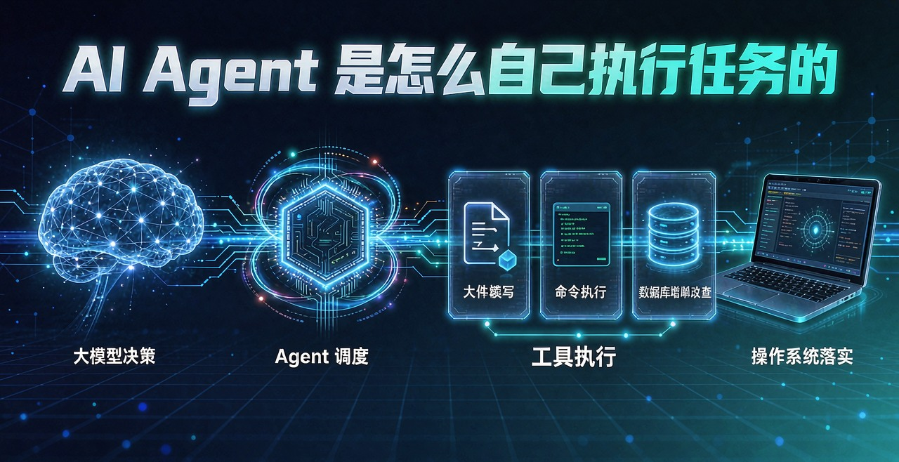
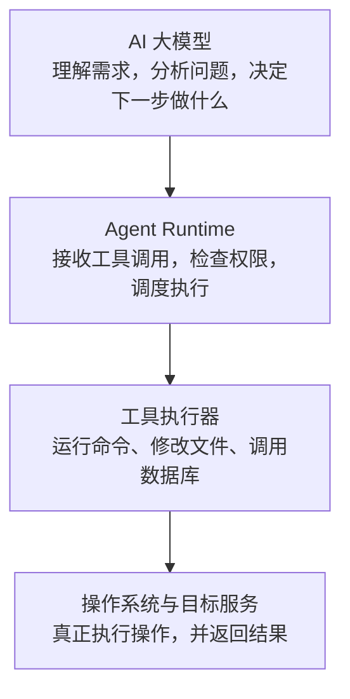
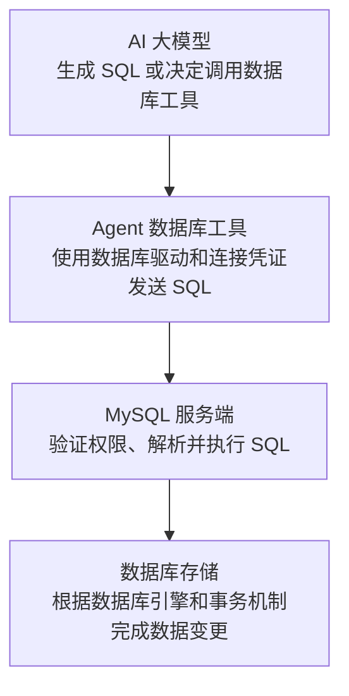

# AI Agent 到底是怎么自己执行任务的？

[[toc]]



在使用 Cursor、Claude Code、Codex 等 AI 编程工具时，我们经常会遇到这样的场景：只需要输入一句话，AI 就能读取项目文件、修改代码、安装依赖、运行测试，甚至操作数据库。

例如，你只需要告诉 AI：

> 帮我分析一下这个项目，修复当前的报错，然后运行测试，直到项目能够正常启动。

接下来，AI 就会开始读取代码、分析错误、修改文件、执行命令，并根据运行结果不断调整方案。整个过程几乎不需要我们手动输入每一条命令。

这就引出了一个很有意思的问题：AI 明明只是一个大语言模型，它为什么能够自己执行任务？它是怎么把一句自然语言变成实际操作的？

理解这个问题，需要弄清楚 AI 大模型、Tool Calling、Agent Runtime、权限管理以及操作系统之间的关系。

## 一、AI Agent 并不是直接操作电脑

首先，我们需要明确一个概念：AI 负责思考和决策，真正执行命令、修改文件和操作数据库的，是 Agent 调用的工具及其背后的运行环境。

大语言模型（LLM）擅长理解自然语言、生成代码、分析问题和制定计划，但模型生成一段代码，并不意味着这段代码已经在你的电脑上运行。

例如，你让 AI 创建一个 React 项目，它可能决定执行以下命令：

```bash
npm create vite@latest my-app
cd my-app
npm install
npm run dev
```

这些命令最初只是 AI 给出的执行方案。只有当 Agent 运行环境接收到相应的工具调用请求，并通过必要的权限检查后，才会真正启动命令。

整个过程涉及四个核心角色。

| 角色            | 主要职责                     |
| ------------- | ------------------------ |
| AI 大模型（LLM）   | 理解需求、分析问题、制定计划、决定调用什么工具  |
| Agent Runtime | 管理任务流程、调度工具、处理权限和执行结果    |
| 工具执行器（Tools）  | 调用终端、文件 API、数据库驱动等完成具体操作 |
| 操作系统与目标服务     | 创建进程、读写文件、执行 SQL，并返回实际结果 |

可以把整个架构理解为：



需要注意，这是一种便于理解的逻辑架构，不同 AI 编程工具的具体实现可能不同。例如，修改文件可以通过专用编辑工具完成，也可以通过 Shell 调用脚本完成；命令也可能运行在本地电脑、容器或者远程开发环境中。

理解了这些角色，才能进一步弄清楚 AI Agent 是如何自己完成任务的。

## 二、AI 如何决定要做什么？

这是 Agent 执行任务的第一步。当用户输入一个任务时，Agent 会将用户需求和必要的上下文发送给大模型。

例如：

> 帮我修复项目启动时报错的问题。

对于这个任务，AI 不一定能直接给出正确的修改方案。它可能需要先了解项目结构、读取 `package.json`、检查配置文件，甚至运行项目来获取错误信息。

因此，AI 会根据当前上下文决定下一步需要做什么。

可能的行动计划如下：

1. 查看项目目录，了解项目结构。
2. 读取 `package.json`，确认使用的框架和启动命令。
3. 运行开发服务器，获取实际错误。
4. 根据错误信息定位问题。
5. 修改相关代码或配置。
6. 重新运行项目，验证问题是否解决。

这就是任务规划的基本过程。

不过，这并不意味着 AI 总会在开始时生成一份完整且固定的计划。很多 Agent 会根据每一步的执行结果动态调整方案。

例如，原本打算修改配置文件，但运行后发现真正的问题是依赖缺失，AI 就可能转而检查依赖版本。

AI Agent 的关键能力，不仅是生成解决方案，还包括根据执行反馈决定下一步行动。

## 三、Tool Calling 让 AI 能够调用工具

这是 Agent 执行任务的第二步。AI 想要执行实际操作，需要有一种机制将自己的决策传递给外部程序。这种机制通常称为 `Tool Calling（工具调用）`，也常被称为` Function Calling`。

> 可以参考文章：[Function Calling详解](/column/AIFuture/基础认知/Function%20Calling详解)

### 3.1 什么是工具调用？

假设 Agent 提供了一个名为 `run_command` 的工具，用于执行终端命令。

工具可以向大模型声明自己的名称、用途和参数，例如：

```json
{
  "name": "run_command",
  "description": "在指定项目环境中执行终端命令",
  "parameters": {
    "type": "object",
    "properties": {
      "command": {
        "type": "string",
        "description": "需要执行的命令"
      }
    },
    "required": ["command"]
  }
}
```

当 AI 判断需要创建项目时，可能返回类似这样的工具调用请求：

```json
{
  "name": "run_command",
  "arguments": {
    "command": "npm create vite@latest my-app"
  }
}
```

以上 JSON 只是用于说明原理的示例，并不是所有模型都采用这种格式。

需要注意的是，这个请求本身并没有执行任何命令。它只是告诉 Agent：我想调用 `run_command` 工具，并传入这些参数。

接下来，才轮到 Agent 程序真正执行操作。

### 3.2 工具调用的完整流程

1. **用户提出需求**：例如创建 React 项目。
2. **大模型生成工具调用请求**：指定工具名称与参数。
3. **Agent 接收并检查请求**：验证参数、检查权限和执行策略。
4. **执行工具并获取结果**：命令运行成功或返回错误。
5. **将结果交回大模型**：决定下一步行动或结束任务。

例如，模型请求执行 `npm install` 后，Agent 运行命令并发现依赖安装失败，就会把错误日志传回模型。AI 分析日志后，可能选择检查 Node.js 版本、修复依赖配置，或者采取其他解决方案。

由此可见，Tool Calling 解决的是模型与外部工具之间的调用问题。它让模型能够提出操作请求，但并不意味着模型可以绕过执行程序，直接控制电脑。

## 四、Agent Runtime 如何把请求变成实际操作？

这是 Agent 执行任务的第三步。如果说` Tool Calling` 负责让 AI 提出工具调用请求，那么`Agent Runtime` 就负责接收、调度和管理这些请求。

你可以把 `Agent Runtime` 理解为整个 `Agent` 的控制中心。

它通常需要完成以下工作：

- 注册和管理可用工具。
- 解析模型返回的工具调用。
- 校验工具参数。
- 根据安全策略决定是否允许执行。
- 调用具体的工具执行函数。
- 收集执行结果并反馈给模型。
- 控制任务循环、异常处理和停止条件。

例如，一个 Agent 可以注册多个工具：

| 工具               | 能力      |
| ---------------- | ------- |
| `read_file`      | 读取文件    |
| `write_file`     | 创建或修改文件 |
| `search_code`    | 搜索代码    |
| `run_command`    | 执行终端命令  |
| `run_tests`      | 运行项目测试  |
| `query_database` | 查询数据库   |

当模型请求调用 `read_file` 时，Runtime 会根据工具名称找到对应的实现；如果请求调用一个不存在的工具，Runtime 就应该拒绝执行。

一个简化的 TypeScript 示例：

```ts
type Tool = {
  name: string;
  execute: (
    args: Record<string, unknown>,
  ) => Promise<string>;
};

const tools = new Map<string, Tool>();

tools.set("read_file", {
  name: "read_file",

  async execute(args) {
    const path = args.path;

    if (typeof path !== "string") {
      throw new Error("文件路径参数无效");
    }

    // 此处接入实际的安全文件读取实现
    return `准备读取文件：${path}`;
  },
});

async function executeTool(
  name: string,
  args: Record<string, unknown>,
): Promise<string> {
  const tool = tools.get(name);

  if (!tool) {
    throw new Error(`不支持的工具：${name}`);
  }

  return tool.execute(args);
}
```

这段代码只是一个工具注册与调度示例，还没有真正读取文件，也没有实现完整的权限控制。

但它展示了一个核心原理：大模型不需要自己实现所有操作，只需要请求调用工具，Runtime 就可以将请求分发给相应的程序。

这也是为什么同一个大模型，在接入不同工具后，能够获得截然不同的能力。

如果只接入文件读取工具，它就只能通过这些工具读取文件；如果进一步接入终端、数据库和浏览器工具，它就可以在授权范围内完成更复杂的任务。

## 五、操作系统才是真正执行命令的地方

这是 Agent 执行任务的第四步。那么，当 AI 调用终端工具时，命令到底是谁运行的？

以 Node.js 为例，程序可以使用 `child_process` 模块启动外部命令。

```ts
import { execFile } from "node:child_process";
import { promisify } from "node:util";

const execFileAsync = promisify(execFile);

async function runTests(): Promise<string> {
  const { stdout, stderr } = await execFileAsync(
    "npm",
    ["test"],
    {
      cwd: "D:\\MyProjects\\my-app",
      timeout: 120_000,
      windowsHide: true,
    },
  );

  return `${stdout}\n${stderr}`;
}
```

当程序调用 `execFile()` 时，Node.js 会通过操作系统提供的机制启动外部进程。随后，npm 执行测试命令，并将执行结果返回给调用程序。

在这个过程中：

1. AI 决定需要运行测试。
2. Agent 将模型的请求交给命令执行工具。
3. 命令执行工具通过 Node.js 启动 npm 进程。
4. 操作系统创建并调度进程。
5. npm 执行测试，并产生输出结果。
6. Agent 收集结果，再将结果交给 AI 分析。

真正运行测试的是 npm 及其启动的相关进程，而不是 AI 大模型。

当然，不同 Agent 可能使用不同的编程语言、执行框架或远程运行服务，但基本原理相同：模型提出操作请求，执行程序负责落实操作。

### 5.1 修改文件也是同样的原理

文件修改不一定需要通过终端完成。Agent 也可以直接使用文件 API。

例如：

```ts
import { readFile, writeFile } from "node:fs/promises";

async function updateConfig(): Promise<void> {
  const path = "src/config.ts";

  const content = await readFile(path, "utf8");

  const updated = content.replace(
    "http://localhost:3000",
    "https://api.example.com",
  );

  if (updated === content) {
    throw new Error("没有找到需要替换的配置");
  }

  await writeFile(path, updated, "utf8");
}
```

当 `writeFile()` 执行时，Node.js 会通过底层文件系统接口发起写入操作。

因此，AI Agent 修改文件通常有两种常见方式：

- 通过专门的文件读取、编辑工具操作文件。
- 通过终端调用脚本，由脚本修改文件。

无论采用哪一种方式，实际的文件写入都由执行环境中的程序完成，并受到操作系统权限等因素的约束。

AI 负责决定修改什么，工具负责实施修改，操作系统负责提供实际的执行能力。

### 5.2 一个完整案例：AI 新增的代码是怎么进入项目的

把上面的机制串起来，就是日常使用 AI 编程工具时最熟悉的场景。

假设你对 AI 说：

> 帮我创建一个 React 登录页面，包含账号、密码和登录按钮。

完整流程大致如下：

1. **大模型生成代码**：根据需求、已有源码和上下文，生成新增或修改内容。
2. **Agent 接收生成结果**：解析工具调用，确定要修改哪些文件、如何修改。
3. **文件工具执行写入**：调用本地文件 API 或其他执行工具，创建、修改项目文件。
4. **项目文件发生变化**：代码保存到工作目录，编辑器显示最新内容。

例如，大模型可能生成这样一个 React 组件：

```tsx
export default function LoginPage() {
  return (
    <div>
      <h1>用户登录</h1>
      <input placeholder="请输入账号" />
      <input
        type="password"
        placeholder="请输入密码"
      />
      <button>登录</button>
    </div>
  );
}
```

但这段代码刚生成时，通常只是模型返回的内容，还没有自动进入你的项目。

接下来，Agent 需要决定把它写入哪个文件，例如 `src/pages/LoginPage.tsx`，再通过文件编辑工具完成写入。

### 5.3 生成在哪里，写入在哪里

这里需要区分两件事：大模型在哪里运行，以及代码在哪里写入。

| 环节         | 可能发生的位置             |
| ---------- | ------------------- |
| 大模型生成代码    | 云端模型服务，或者本地运行的模型    |
| Agent 调度工具 | 本地电脑、远程开发环境或其他运行环境  |
| 文件写入       | 本地文件系统，或者远程工作区的文件系统 |
| 项目运行与测试    | 本地终端、容器或远程服务器       |

假设你在 Windows 上打开项目：

```text
D:\MyProjects\my-app
```

你使用的模型运行在云端，但 Agent 的执行环境位于你的电脑上。那么典型的过程就是：

1. 本地 Agent 将你的需求和必要的代码上下文发送给云端模型。
2. 云端模型生成代码或返回工具调用请求。
3. 本地 Agent 获取生成结果。
4. 本地文件工具将代码写入 `D:\MyProjects\my-app`。
5. 你的编辑器检测到文件变化，显示修改后的代码。

在这种情况下，云端大模型负责生成代码，本地 Agent 负责执行文件写入。

不过，并不是所有工具都采用这种架构。有些使用远程容器或云端开发环境，代码可能先写入远程工作区；有些还会通过同步机制将修改传回本地。

### 5.4 并不是所有新增代码都由大模型生成

除了模型直接生成，项目里的新代码还可能来自工具本身的执行结果，常见的有三种情况：

- **大模型生成代码**：模型直接生成新的组件、函数或配置内容。
- **工具执行代码**：Agent 调用脚手架、代码生成器或格式化工具，由这些程序生成或调整文件。
- **混合完成**：大模型生成主要逻辑，Agent 再通过文件工具写入代码，运行格式化、构建或测试工具进行验证。

例如，你让 AI 创建一个 Vite 项目：

```bash
npm create vite@latest my-app
```

此时，Vite 脚手架会创建基础项目文件，并不是所有文件都由大模型逐个生成。

随后，如果你让 AI 编写业务页面，大模型才可能直接生成 React 组件，并由 Agent 写入项目。

### 5.5 写完之后：AI 怎么知道代码有没有问题

代码写入文件后，Agent 可以继续执行构建或测试命令：

```bash
npm run build
```

如果构建失败，工具会返回错误日志。大模型读取日志，分析问题，再决定是否修改代码。

整个流程就是：

```text
生成代码 → 写入文件 → 执行测试 → 获取错误 → 修改代码 → 再次验证
```

这套“执行—反馈—再执行”的机制，就是后面要展开的 Agent 执行循环。所以，AI 编程工具看起来像是直接在你电脑上写代码、改代码，实际上是大模型、Agent 和执行工具共同完成的。

> **大模型生成的是代码内容，真正把代码保存到项目里的，是拥有相应文件访问权限的执行程序。**

## 六、为什么给 AI 授权后，它就能执行增删改查？

使用 AI 编程工具时，我们经常会看到这样的提示：

```text
AI 请求执行以下命令：

npm install

是否允许执行？
```

当用户点击“同意”后，AI 就可以继续完成后续操作。

但这里有一个容易误解的地方：用户同意的通常是某次工具调用，或者某一类操作的执行权限，并不意味着 AI 自动获得了整个电脑的无限权限。

### 6.1 权限控制究竟控制什么？

通常需要区分三个层次。

| 权限层次       | 决定什么           | 示例             |
| ---------- | -------------- | -------------- |
| Agent 工具权限 | 是否允许调用某个工具     | 是否允许执行终端命令     |
| 操作系统权限     | 当前进程能够访问哪些系统资源 | 是否能够修改某个目录中的文件 |
| 目标服务权限     | 账号能够操作哪些外部资源   | 数据库账号能否删除记录    |

例如，你允许 AI 执行 `npm install`，通常只是允许它运行这条命令。如果当前进程没有访问某个目录的权限，操作仍然可能失败。

反过来，如果 Agent 运行在高权限环境中，并且可以执行任意命令，那么它能够造成的影响也可能很大。

实际工具的授权方式各不相同。有些操作每次都需要确认，有些允许在特定范围内自动执行，还有些会使用沙箱、命令白名单或其他限制机制。

### 6.2 数据库的增删改查是谁执行的？

假设你让 AI 执行以下 SQL：

```sql
UPDATE users
SET status = 'active'
WHERE id = 1001;
```

完整流程通常是：



真正执行 SQL 的是 MySQL 服务端，而不是 AI 大模型。

如果数据库账号只有 `SELECT` 权限，那么即使 AI 生成了 `UPDATE` 或 `DELETE` 语句，数据库也会因为权限不足而拒绝执行。

如果 Agent 使用具有完整写入权限的账号，并且没有其他安全限制，那么它就可能修改甚至删除大量数据。

因此，开发 AI Agent 时，不能只关注模型的能力，还必须关注工具使用了什么账号、拥有什么权限，以及能够访问哪些资源。

## 七、AI 为什么能够连续执行几十条命令？

前面介绍了单次工具调用的过程，但 AI 编程工具真正强大的地方，在于它能够连续调用多个工具，并根据执行结果动态调整方案。

这套机制通常被称为 Agent Loop（Agent 执行循环）。

假设你给 AI 一个任务：

> 分析项目，修复报错，安装依赖，运行测试，直到项目能够正常启动。

Agent 可能按照以下过程执行：

1. **分析项目**：读取目录结构、配置文件和关键源码。
2. **定位错误**：运行项目或测试，获取真实错误信息。
3. **修改代码**：根据错误原因调用文件编辑工具。
4. **运行命令**：安装依赖、重新构建或执行测试。
5. **分析结果**：读取日志，判断问题是否已经解决。
6. **继续迭代**：如果仍有错误，调整方案并再次执行。

当任务完成、遇到无法解决的问题、达到执行限制或需要用户决策时，循环就会停止。

这个过程并不是一开始就把所有命令生成好，然后不加判断地执行。

更典型的情况是：AI 每完成一个阶段，就根据工具返回的结果决定下一步行动。

例如：

- 第一次测试发现依赖缺失，AI 决定安装依赖。
- 第二次测试发现 TypeScript 类型错误，AI 决定修改代码。
- 第三次测试仍然失败，AI 根据新的日志继续定位。
- 最终测试通过，AI 汇总修改内容并结束任务。

这就是 AI Agent 与普通聊天机器人的重要区别：它不仅能够生成答案，还能通过工具获取外部信息、执行动作，并利用反馈推进任务。

不过，Agent 并不保证一定能够解决问题。它也可能误判原因、重复尝试或采用错误的修复方式，因此真实系统通常需要设置超时、重试上限、执行预算和人工审批机制。

## 八、如果自己开发一个 AI Agent，需要什么？

理解了底层原理后，就可以进一步思考：如果使用 TypeScript 和 Node.js 开发自己的 AI Agent，应该如何设计？

一个基础的 Agent 通常可以拆分为四个模块。

| 模块                 | 核心职责                    |
| ------------------ | ----------------------- |
| LLM Client         | 调用大模型 API，获取文本回答或工具调用请求 |
| Tool Registry      | 注册和管理文件、终端、数据库等工具       |
| Permission Manager | 检查权限，管理审批和安全策略          |
| Agent Loop         | 调度工具、收集执行结果、控制任务循环      |

整体架构如下：

```text
用户提出任务
    ↓
LLM Client 调用大模型
    ↓
模型返回回答或工具调用请求
    ↓
Agent Loop 解析请求
    ↓
Tool Registry 找到对应工具
    ↓
Permission Manager 检查权限
    ↓
工具执行器运行实际操作
    ↓
操作系统 / 数据库 / 外部服务
    ↓
执行结果返回 Agent
    ↓
继续调用模型，直到任务完成
```

需要注意，这是一种逻辑上的模块划分。实际框架可能将这些功能整合在一起，也可能把命令执行和权限检查交给独立的服务。

开发时，可以先从一个简单的 Agent 开始：

1. 接入一个支持工具调用的大模型。
2. 注册文件读取和代码搜索工具。
3. 实现工具调用与结果反馈循环。
4. 增加文件编辑和测试执行能力。
5. 实现权限校验、人工审批和执行日志。
6. 最后再考虑数据库、远程执行和多 Agent 协作。

不要一开始就向模型开放不受限制的 Shell 执行能力。 更合理的做法是从能力有限的工具开始，逐步增加权限，并为高风险操作设置明确的边界。

## 九、最后总结

`AI Agent` 到底是怎么自己执行任务的？

答案其实可以归纳为一句话：

**大模型负责决定做什么，Agent Runtime 负责组织和调度，工具负责执行具体操作，操作系统与目标服务负责真正落实操作。**

整个过程可以概括为以下几个关键环节：

- **任务规划**：AI 理解需求，分析问题，决定下一步行动。
- **Tool Calling**：AI 按照约定格式提出工具调用请求。
- **Agent Runtime**：接收请求、调度工具、检查权限并管理执行流程。
- **工具执行**：通过文件 API、Shell、数据库驱动等完成具体操作。
- **反馈循环**：将执行结果返回模型，根据结果继续推进任务。

当我们看到 AI 自动修改代码、运行测试甚至操作数据库时，实际上是大模型的推理能力与外部工具的执行能力协同工作的结果。

理解这套机制后，就不难发现：AI Agent 并不是什么能够绕过操作系统规则的特殊程序。它本质上是一种将大模型与工具执行系统结合起来的自动化系统。

真正决定一个 Agent 能力上限的，不只是模型本身，还包括它接入了什么工具、如何组织任务、能访问哪些资源，以及有没有完善的安全控制。

这也是从“会使用 AI 编程工具”走向“能够开发自己的 AI Agent”时，最值得理解的一层底层原理。
