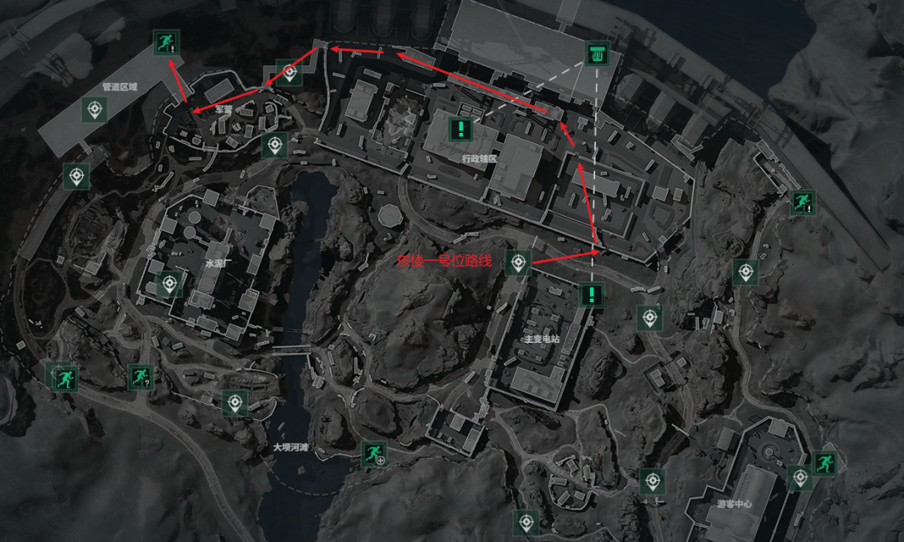
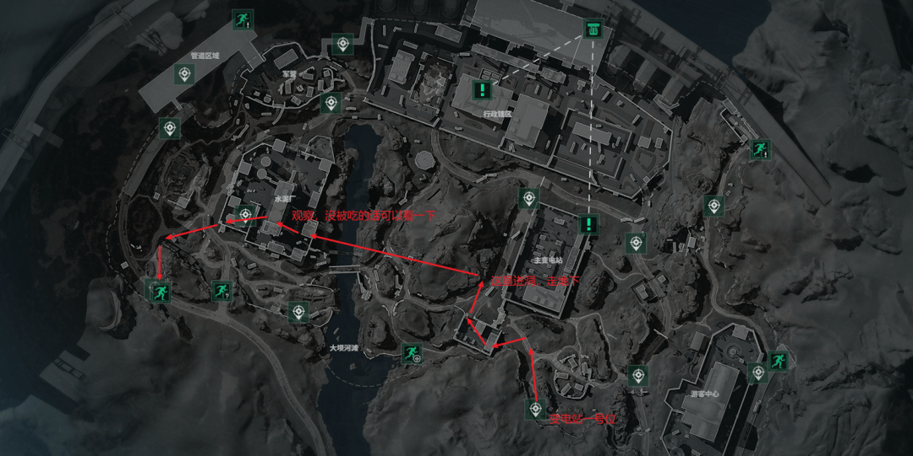
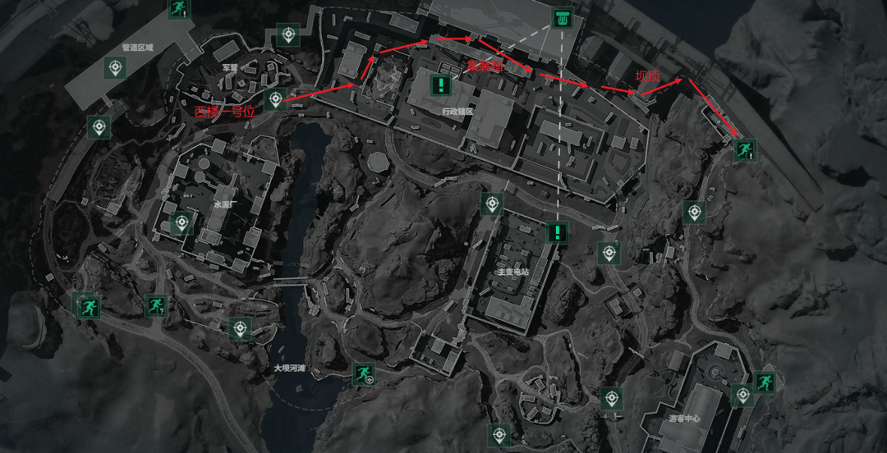
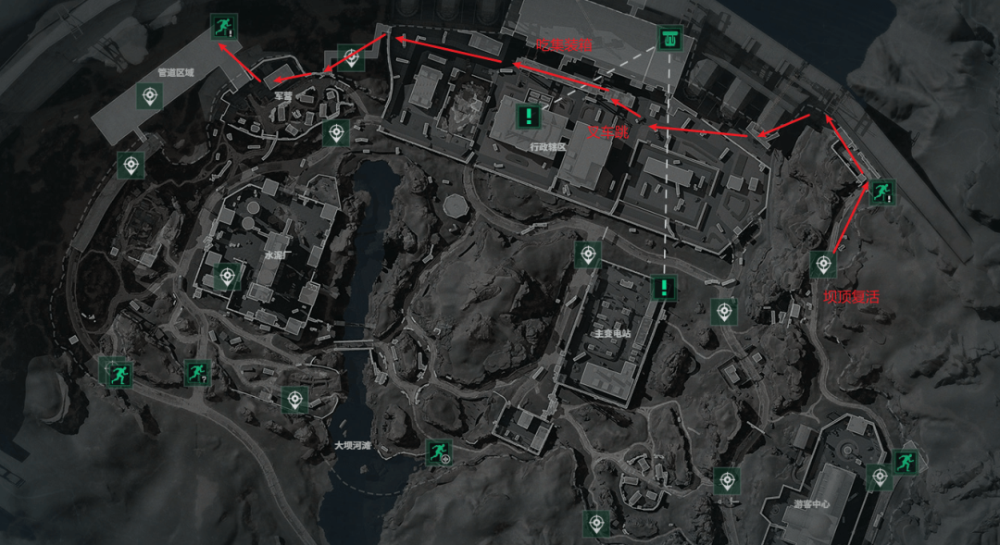
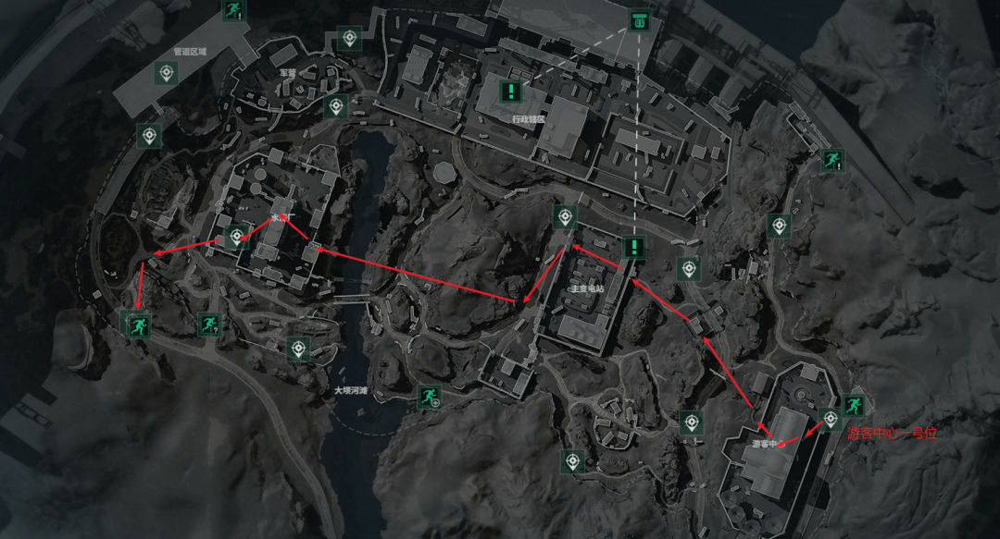
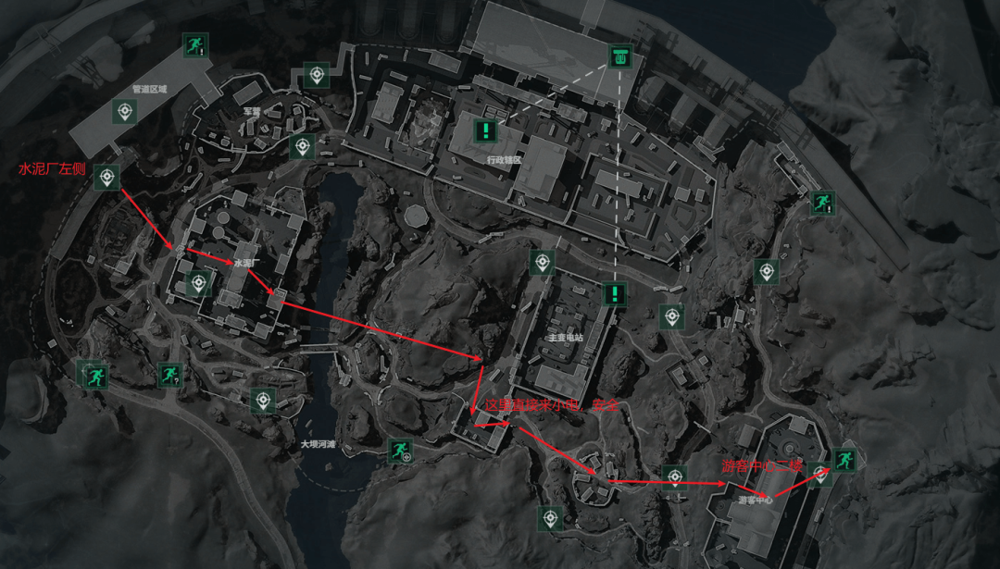
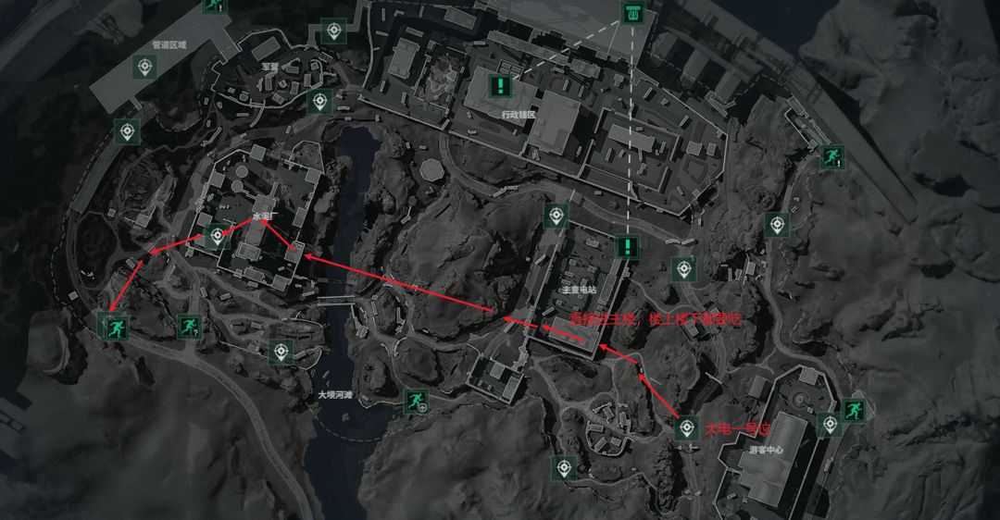

# 三角洲行动攻略总结

[[toc]]

> 本文整理了《三角洲行动》中「烽火地带」模式的跑图路线、必吃物资点，以及战场模式操作、改枪思路、枪械与子弹的性价比心得。

## 一、烽火地带

### 1. 跑刀推荐（基础配装）

| 项目     | 推荐                                          |
| -------- | --------------------------------------------- |
| 干员     | 威龙                                          |
| 胸挂     | 17 格（DRC 先进侦查包）                       |
| 背包     | 15 格（露营背包）                             |
| 手枪     | G18                                           |
| 药品     | 强效注射器 ×2、止痛药 ×1、止血带 ×1           |
| 子弹     | 手枪弹 3 级，保证 30 发                       |
| 房卡     | 只推荐 3 张：水泥厂办公室、变电站技术室、变电站宿舍 |

> 枪械中最贵的是 **M250**。

### 2. 各复活点跑图路线

#### ① 东楼一号位

直接去吃航空箱，楼上楼下都看 → 破窗后直接去集装箱，站在叉车上面可以直接喷气对着角 → 走通道到军营 → 丢包撤离。

> 物资点详见 3.（3）行政楼-东楼、3.（5）军营。

#### ② 小电站一号位

直接去小站，爬空调外机进二楼 → 对面房间吃航空箱 → 走地下通道到水泥厂 → 吃完水泥厂从左上角撤离。

> 物资点详见 3.（2）小变电站 → 大变电站、3.（6）水泥厂。

#### ③ 西楼一号位

直奔集装箱 → 绳索走坝顶负重撤离。

> 物资点详见 3.（4）行政楼-西楼。

#### ④ 管道内复活

也是去集装箱，路过军营先吃盾兵、拔他的背包 → 走左边通道去集装箱区域 → 绳索走坝顶负重撤离。

> 物资点详见 3.（5）军营。

#### ⑤ 坝顶复活

从上面直奔集装箱 → 走左边通道去军营，夺舍盾兵和二楼电脑 → 丢包撤离。

> 物资点详见 3.（5）军营。

#### ⑥ 游客中心一号位

翻窗进二楼，吃完直接破窗下去 → 吃高架下面的鸟窝 → 往养护站方向走，也吃鸟窝 → 看情况是否进大变电站（尽量不去）→ 走地下通道到水泥厂，先吃二楼平台，再跳下去吃联排房 → 左下角撤离。

> 物资点详见 3.（1）游客中心、3.（6）水泥厂。

#### ⑦ 水泥厂附近（水泥厂 → 小变电站 → 游客中心）

先进水泥厂，然后走地下通道到小变电站，最后从游客中心撤离。

> 物资点详见 3.（6）水泥厂、3.（2）小变电站 → 大变电站、3.（1）游客中心。

#### ⑧ 大电站一号位

直接去大电站主房间，楼上楼下都吃 → 走地下通道进水泥厂，看有没有敌人 → 去二楼吃剩饭 → 鸟窝撤离。

> 物资点详见 3.（2）小变电站 → 大变电站、3.（6）水泥厂。

### 3. 各地图必吃物资点

#### （1）游客中心

- 二楼：火箭兵必吃。
- 破窗之后右手边三楼：茶几桌面必看。
- 跳楼后左侧厕所：开门有一个医疗包。
- 最里面的房子：桌底下的电脑机箱。
- 出门正北方：医疗包和展厅。
- 从木板翻出去后左前方露台：有一个武器箱。
- 野外营：左边帐篷、右侧卡车的帐篷。

#### （2）小变电站 → 大变电站

- 小变电站二楼第一个房间：有小保险。
- 一楼：有一个机箱。
- 对面房间：航空箱。
- 前往大变电站：门口是水泥车。
- 进去之后左边：弹药箱。
- 右边房间：白衣服要摸，桌面要看，两个服务器地上也要看，打死的盾兵盒子要吃。
- 二楼：所有桌面都要看，可能有大红。
- 破窗往北走：路过医疗箱吃一下。
- 从空调外机踩着墙跳出变电站缺口，视角左转走停车场进入东楼。

#### （3）行政楼-东楼

- 水泥车必吃。
- 仓库每一个角落都要吃，仓库左边的二楼也要吃。
- 翻窗后正前方房间：右手边的白大褂。
- 最里面的书房：开门进去右转走到底还有一个小门，里面有电脑机箱；左手边桌子上会刷房卡。
- 走出书房后右手边：有医疗箱。
- 左边设备领用室：白大褂。
- 东楼二楼上楼后的经理室：会刷金条，小保险。

#### （4）行政楼-西楼

- 阳台房桌子底下：有电脑箱；每个桌面都要看。
- 洗手池和南厕所。
- 拉闸房间：有一个服务器和桌面要看。
- 隔壁黑屋：有电脑机箱。
- 男厕所破窗出去后，下面集装箱：有武器箱。
- 西楼一楼健身房：有一个大武器箱、白大褂和服务器。
- 西楼地下室入口红灯区：有一个弹药箱。
- 地下大门敞开的房间：有一个机箱。
- 出房间往前：有一个电脑骇客。
- 从地下室到东楼的集装箱区域也要吃。

#### （5）军营

- 所有帐篷和高台屋子二楼的骇客电脑都要看。
- 电脑附近的桌面上也可能有好东西。

#### （6）水泥厂（最肥）

1. 先吃左边的水泥车。
2. 钻洞进管道，尽头有大武器箱。
3. 钻洞开门下楼，吃水泥厂平台下的水泥车。
4. 往正西北方看，有一个水泥车和卷帘房；卷帘房左手边有一个暗门，里面是手提包。
5. 出门往右后方走，上楼小道直达水泥厂二楼平台，此处有两个武器箱和航空箱。
6. 踩住黄色的护手大跳，进入火箭兵平台，后面的大武器箱。
7. 走边缘下瓦房，有一个鸟窝。
8. 直接跳下去，刚好有一个房间，里面有航空箱。
9. 出门东南方，水泥厂办公室有一个衣服和电脑机箱，踹门出去就可以撤离了。

## 二、战场模式操作

| 按键       | 功能       |
| ---------- | ---------- |
| 5          | 选择支援   |
| 鼠标中键   | 标记敌人   |
| G          | 丢投掷物   |
| Q / E      | 探头       |
| C / Z      | 蹲 / 趴    |

## 三、改枪心得

- **子弹在准星周围晃动**：找「枪身稳定性」词条，和「据枪稳定性」无关。
- **镜头晃动**：和「据枪稳定性」有关，据枪稳定性越高，开火时的镜头晃动越小。

## 四、裸枪最佳性价比属性（阈值）

| 属性     | 加成区间 | 阈值范围   |
| -------- | -------- | ---------- |
| 后坐力   | +8 / -0  | -9 / +∞    |
| 据枪     | ±8       | -20 / +16  |
| 操控速度 | ±15      | -30 / +28  |
| 腰射     | ±10      | -40 / +∞   |

> 激光开启后：操纵 +6，腰射 +12。

## 五、枪械等级（级别越高越贵）

| 等级 | 价格    | 枪械                                                                                                                        |
| ---- | ------- | --------------------------------------------------------------------------------------------------------------------------- |
| 一级 | 约 1w   | UZI 冲锋枪、野牛冲锋枪、CAR-15 突击步枪、AKS-74U 突击步枪                                                                   |
| 二级 | 3–5w    | 勇士冲锋枪、SMG45 冲锋枪、MP5 冲锋枪、PTR-32 冲锋枪、SG552 突击步枪、G3 战斗步枪、QBZ95-1 突击步枪、杠杆式步枪、R93 狙击步枪 |
| 三级 | 8–13w   | 腾龙突击步枪、AKM 突击步枪、SCAR-H 战斗步枪、AUG 突击步枪、MCXLT 突击步枪、MK4 冲锋枪、SR-3M 突击步枪、QCQ171 冲锋枪、P90 冲锋枪、PSG-1 射手步枪、M14 射手步枪、M700 狙击步枪 |
| 四级 | 13–20w  | AS-val 突击步枪、M7 战斗步枪、KC17 突击步枪、MK47 突击步枪、MP7 冲锋枪、AWM 狙击步枪                                          |

## 六、子弹等级（1–6 级）

- **4 级弹**：整个游戏的性价比天花板。对 1–5 级护甲造成的伤害都是 100%，只有对 6 级甲时会衰减为 60%。
- **3 级弹**：想要去打架，子弹不能低于 3 级。
- **5 级弹**：猛攻哥专用，对 1–6 级护甲造成的伤害都是 110%。
- **6 级弹**：主要给狙击枪专用，6 级以下基本秒杀。

## 七、常见黑话速查

> 以下为正文中出现的黑话整理，含义以本文语境为准。

| 黑话             | 含义                                                             |
| ---------------- | ---------------------------------------------------------------- |
| 跑刀             | 轻装跑图：不带大枪（或只带手枪），以快速搜刮物资、避开战斗为目的 |
| 一号位           | 某片区域的固定出生 / 复活位置                                    |
| 破窗             | 打破窗户作为进入或通过的路线                                     |
| 喷气             | 威龙的喷气                                 |
| 航空箱           | 高价值物资箱，容易开出好东西                                     |
| 小保险           | 小型保险箱类                                                 |
| 大红             | 红色品质的高价值物资                                             |
| 白大褂           | 地图上挂有白大褂的衣服                                   |
| 骇客             | 可交互的电脑 / 终端类容器                                        |
| 鸟窝             | 地图上的一处搜刮点（鸟巢状物资点）                               |
| 夺舍             | 击杀敌人后扒下并占用对方的装备                                   |
| 盾兵 / 火箭兵    | 地图中的特殊敌人，分别持盾、持火箭筒                             |
| 联排房 / 瓦房    | 地图上的建筑类型，分别为连排房、瓦顶房                           |
| 得吃             | 口语，指“要搜刮、要拿走”                                         |

## 八、撤离方式速查

> 以下为正文中出现过的撤离方式汇总，具体撤离点位置以游戏内为准。

| 撤离方式          | 说明                                             | 出现路线                |
| ----------------- | ------------------------------------------------ | ----------------------- |
| 常规撤离          | 从地图常规撤离点撤离（文中以左上角 / 左下角表示） | ② 小电站、⑥ 游客中心   |
| 丢包撤离          | 丢下背包、轻装撤离                               | ① 东楼、⑤ 坝顶         |
| 负重撤离          | 背着高负重物资、走绳索到坝顶负重撤离             | ③ 西楼、④ 管道内       |
| 鸟窝撤离          | 从鸟窝方向撤离                                   | ⑧ 大电站                |
| 踹门 / 破窗撤离   | 踹门或破窗直接离开                               | 3.（6）水泥厂           |
