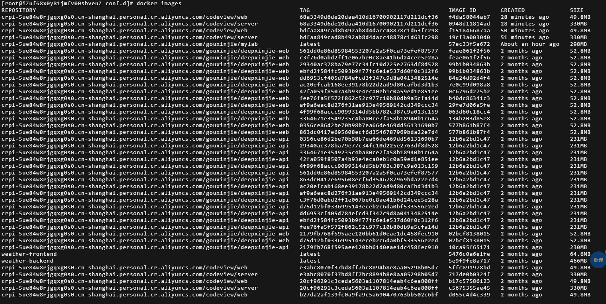
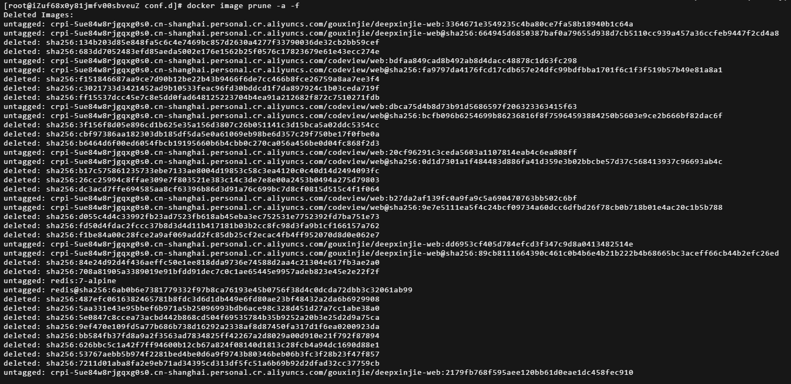
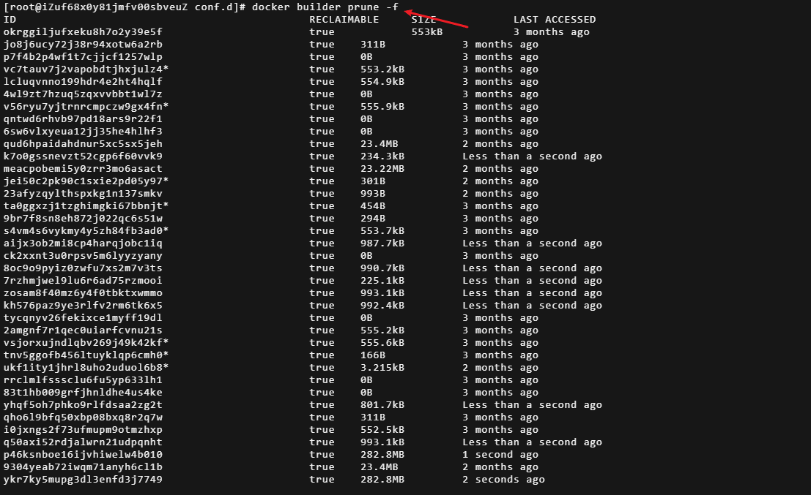

# ECS 服务器 Docker 镜像堆积清理实战：安全释放 4.6GB

[[toc]]

## 前言

服务器用久了，`docker images` 列表越来越长——同一个项目因为 CI 每次提交都打一个新 tag 推送，导致本地堆积了几十个历史镜像，磁盘告急。直接 `docker rmi` 又怕删错正在用的镜像。本文记录一次完整的排查与安全清理过程。

## 问题背景

先看清理前的镜像列表（已节选）：

使用 `docker images` 命令：

```liunx
[root@iZuf68x0y81jmfv00sbveuZ conf.d]# docker images
REPOSITORY                                                    TAG                    IMAGE ID       CREATED       SIZE
crpi-xxx.com/codeview/web                                    68a3349d...            f4da58044ab7   28 min        49.8MB
crpi-xxx.com/codeview/server                                 68a3349d...            0948d11814ad   28 min        330MB
crpi-xxx.com/codeview/web                                    bdfaa849...            f151846687aa   50 min        49.8MB
crpi-xxx.com/codeview/server                                 bdfaa849...            19cf3a0030d0   51 min        330MB
crpi-xxx.com/gouxinjie/deepxinjie-web                        561dd0e8...            feae061f2f56   2 months      52.8MB
crpi-xxx.com/gouxinjie/deepxinjie-web                        c3f76d0a...            feae061f2f56   2 months      52.8MB
... （共几十个历史 hash tag）
```

如图：



特征很明显：

- `codeview/web`、`codeview/server` 有大量以 **git commit hash 作为 tag** 的历史版本；
- `deepxinjie-web`、`deepxinjie-api` 各有十几个旧版本；
- 还混着 `redis:7-alpine`、`nginx:1.27-alpine` 等可能已不用的公共镜像。

## 核心认知：删除镜像的唯一风险

删除镜像的**唯一**风险就是：删掉了**正在被容器使用**的镜像（包括已停止、但之后还要重启的容器）。

只要镜像还在某个容器的 `IMAGE` 列里，就不能删。除此之外的历史镜像，尤其是「已推送到镜像仓库」的 hash tag，本地删除是低风险的——需要时还能 `docker pull` 重新拉回来。

## 第一步：摸清容器与镜像的对应关系

先看清楚「谁在用哪个镜像」，这是后续一切操作的前提：

```bash
docker ps        # 正在运行的容器
docker ps -a     # 所有容器（含已停止的）

# 用表格一次看清 容器名 -> 镜像 -> 状态
docker ps -a --format 'table {{.Names}}\t{{.Image}}\t{{.Status}}'
```

输出示例：

```text
NAMES              IMAGE                                                            STATUS
codeview-web       crpi-xxx.com/codeview/web:68a3349d...                            Up 32 minutes
codeview-server    crpi-xxx.com/codeview/server:68a3349d...                         Up 32 minutes
mylab              crpi-xxx.com/gouxinjie/mylab:latest                              Up About an hour
deepxinjie-web     crpi-xxx.com/gouxinjie/deepxinjie-web:c3f76d0a...                Up 2 months
deepxinjie-api     crpi-xxx.com/gouxinjie/deepxinjie-api:c3f76d0a...                Up 2 months
deepxinjie-db      mysql:8.0                                                        Up 2 months
weather-frontend   weather-frontend:latest                                          Up 2 months
weather-backend    weather-backend:latest                                           Up 2 months
```

**关键判断**：本案例中所有容器都是 `Up` 状态，**没有「已停止但占着旧镜像」的容器**。这就意味着可以直接用自动清理命令，它只会删「没有被任何容器引用」的镜像。

## 第二步：清理悬空镜像（零风险）

悬空镜像是 `<none>:<none>`，没有任何 tag 引用，可放心删除：

```bash
docker image prune -f
```

```liunx
[root@iZuf68x0y81jmfv00sbveuZ conf.d]# docker image prune -f
Total reclaimed space: 0B
```

> 本案例的列表里其实没有 `<none>:<none>`，所以这步删不了什么(显示：`Total reclaimed space: 0B`)，真正的对象是历史 commit 版本。但它作为日常清理习惯仍然值得保留。

## 第三步：清理未使用的历史镜像（关键一步）

由于确认了「没有停止容器占坑」，直接用 `-a` 参数删除**所有未被容器引用的镜像**：

```bash
docker image prune -a -f
```

这一条命令会自动识别并保留正在使用的 9 个镜像，删除其余全部历史版本。执行结果（节选）：

```text
Deleted Images:
deleted: sha256:134b203d85e8...
deleted: sha256:f151846687aa...
deleted: sha256:99b1b034863b...
deleted: sha256:10ca95f65171...
deleted: sha256:6769dc3a703c...
...
Total reclaimed space: 1.246GB
```
如图：


### 为什么只回收了 1.246GB？

之前按 `docker images` 里的 `SIZE` 列估算约 3.8GB，实际只回收 1.246GB。原因是 **Docker 镜像层大量共享**：

- `SIZE` 列是「引用后的逻辑大小」之和；
- 不同镜像共享同一个基础层（如 alpine/node 基础层）；
- 真正落盘的唯一层远少于 `SIZE` 之和。

这是正常现象，不代表没删干净。

## 第四步：清理构建缓存

镜像删完后，再清一层构建缓存：

```bash
docker builder prune -f
```

输出中列出所有可回收缓存，最后一行 `Total: 3.4GB` 即本次可回收的构建缓存总量。

如图：



如果还想更彻底（连当前镜像的构建层缓存也一起删），可加 `-a`：

```bash
docker builder prune -a -f
```


> **注意代价**：`-a` 会删除所有构建缓存，下次重新 `docker build` 项目会变慢（层缓存失效），但**对正在运行的容器没有任何影响**。

## 效果总结

| 操作 | 回收空间 | 说明 |
|---|---|---|
| `docker image prune -a -f` | 1.246GB | 历史镜像（含共享层） |
| `docker builder prune -f` | 约 3.4GB | 构建缓存 |

两项合计约 **4.6GB**，且 9 个运行中的容器全程不受影响。

最终确认可用：

```bash
docker system df
```

## 避坑指南

1. **绝对不要碰 `docker volume prune`**
   服务器上跑着 `mysql:8.0`，数据库数据几乎肯定存在数据卷里，盲目清卷可能直接清掉数据库。确认有备份前不要动卷。

2. **先 `docker ps -a` 再删**
   有「已停止容器」时，`docker image prune -a` 不会删停止容器引用的镜像，但手动 `docker rmi` 可能会删掉。所以手动删除前务必核对。

3. **`-a` 与构建缓存**
   `docker builder prune` 不带 `-a` 只删「悬空」缓存，带 `-a` 才删「所有未使用」缓存，按需选择。

## 根治方案：CI 侧限制本地镜像堆积

历史镜像的根源是 CI 每次提交都打 hash tag 推送，本地从不清理。可以在 CI 推送后加一步「只保留最近 N 个版本」：

```bash
#!/usr/bin/env bash
# 推送后清理本地旧镜像：每个仓库只保留最近 3 个版本
set -e

REPO="crpi-xxx.com/gouxinjie/deepxinjie-web"
KEEP=3

# 按创建时间排序，跳过前 KEEP 个，删除更早的镜像
docker images "$REPO" --format '{{.CreatedAt}}\t{{.ID}}' \
  | sort -r \
  | tail -n +$((KEEP + 1)) \
  | awk '{print $2}' \
  | xargs -r docker rmi -f
```

也可以配合 `cron` 或部署脚本定期执行 `docker image prune -f`，避免镜像再次堆积。
