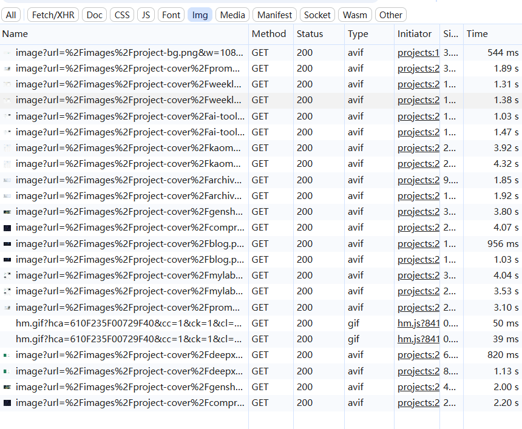
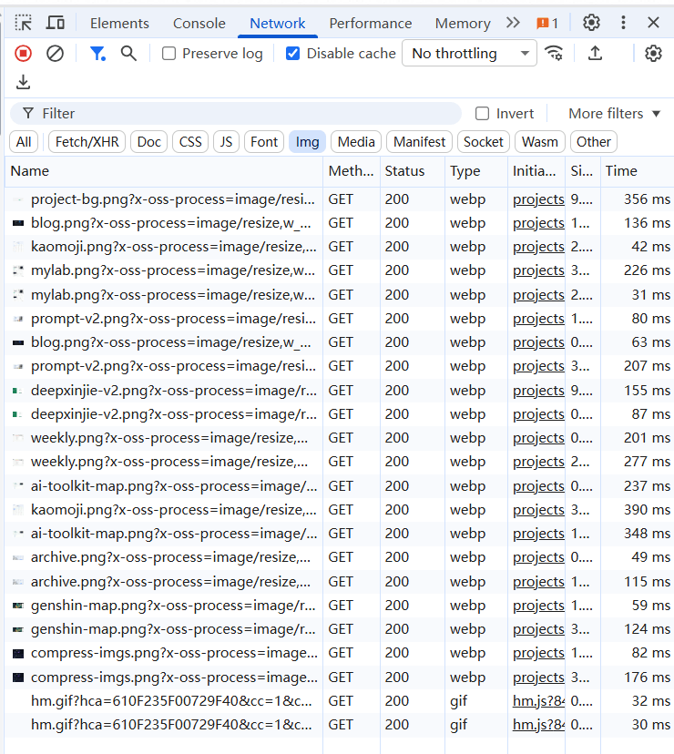

# 图片替换为 OSS 后加载依旧慢的原因排查

[[toc]]

> 一句话结论：**图片换成 OSS 不等于加速——只要图片还绕回应用服务器转码，慢的问题就还在。**


## 一、前因与现象

站点图片原本放在 `public/images/`，随源码打进 Docker 镜像——图片多、单张几百 KB 到 1MB，既拖慢构建部署，也拉高服务器带宽压力。

于是把图片全量迁到阿里云 OSS，**本以为"放云端 = 变快"**。结果上线后**加载依旧慢**：单张图仍要 1~7 秒，Network 面板里一排 `pending`。


## 二、排查：慢到底在哪一步

打开 `Network` 面板，先看**请求的域名**——这是排查图片问题的第一步。

**如图：**



看到的结果：请求打的是 `gouxinjie.com/_next/image`，**不是 OSS**。也就是说浏览器没有直连 OSS，而是把 OSS 地址当参数传给站内接口。

把实际请求链路逐段拆开：

```
① 浏览器请求图片
        │  gouxinjie.com/_next/image（OSS 地址藏在参数里）
        ▼
② Nginx 转发到 Next.js
        ▼
③ Next.js 从 OSS 下载原图（比如 1MB 的 PNG）
        ▼
④ Next.js 解码 + 缩放 + 转码成 AVIF   ← 慢就慢在这一步
        │   CPU 密集，单张 0.4~1.3 秒
        ▼
⑤ 把转码结果返回给浏览器
```

问题在第 ④ 步：**真正耗时的"转码"是应用服务器干的**。而"图片换到 OSS"这件事，只改变了第 ③ 步——从"读本地磁盘"变成"从 OSS 下载"。省下的是微秒级磁盘读取，最贵的转码工序一步没省，反而多了一次同城网络往返。

## 三、根因（两个）

1. **转码一直在应用服务器上**。`next/image` 会把 PNG 现场转成 AVIF，这是 CPU 密集操作，图片量大时就是瓶颈。
2. **优化缓存从不命中**。`.next/cache` 目录归 root、进程以非 root 用户运行，缓存写不进去。于是每个请求都完整走一遍"下载 → 解码 → 缩放 → 编码"，从不复用。实测同一 URL 连续请求，`X-Nextjs-Cache` 恒为 `MISS`。

> 串起来看前因后果：**为了提速而迁 OSS，结果只换掉了"从哪取原图"这一步——真正耗时的转码还压在服务器上，缓存又没生效，于是预期落空、依旧慢。** 误判的根源，是把 OSS 当成了 CDN：OSS 负责"存"，不会替你"转码"。

## 四、解决：把转码从服务器搬到 OSS

对应两个病根，做两件事：

1. **让 OSS 接管转码**：图片地址带上 `x-oss-process` 参数，配合 `unoptimized` 跳过站内优化，浏览器直连 OSS。
2. **修缓存权限**：让剩下的少数 `next/image` 请求（如远端 GitHub 头像）能命中缓存。

优化后的请求链路：

```
① 浏览器直接请求 OSS 图片地址
        │  https://<bucket>.oss-cn-shanghai.aliyuncs.com/images/xxx.png
        │  ?x-oss-process=image/resize,w_828/format,webp/quality,75
        ▼
② OSS 下载原图 + 缩放 + 转码（OSS 分布式图片处理，0.1~0.4 秒）
        ▼
③ OSS 缓存处理结果，重复请求直接命中
        ▼
④ 返回 webp 给浏览器
        │
        └── 应用服务器从头到尾不参与
```

对比：**转码位置从"你的服务器"移到了"OSS"，服务器彻底退出图片链路。**

## 五、核心代码

```ts
// utils/oss.ts —— 把「路径 + 尺寸」翻译成 OSS 处理地址
export const ossImageUrl = (path, { width, height, format = "webp", quality = 75 } = {}) => {
  if (!path || !OSS_BASE_URL) return path;
  const clean = path.split("?")[0];
  // 只处理自己的图片；svg / gif 等不支持格式原样返回
  const own = clean.startsWith("/images/") || clean.startsWith(`${OSS_BASE_URL}/`);
  if (!own || !/\.(png|jpe?g|webp|bmp|tiff?)$/i.test(clean)) return path;

  const resize = [width && `w_${width}`, height && `h_${height}`].filter(Boolean).join(",");
  const ops = [resize && `image/resize,${resize}`, `format,${format}`, `quality,${quality}`]
    .filter(Boolean)
    .join("/");
  const base = clean.startsWith("/") ? `${OSS_BASE_URL}${clean}` : clean;
  return `${base}?x-oss-process=${ops}`;
};

export const isOssProcessed = (url) => url.includes("x-oss-process=");
```

```tsx
// 组件里：关键在 unoptimized，跳过站内二次转码
const cover = ossImageUrl(project.covers[0], { width: 828 });
<Image src={cover} fill unoptimized={isOssProcessed(cover)} loading="lazy" />
```

```dockerfile
# Dockerfile：修缓存权限
RUN mkdir -p /app/.next/cache/images && chown -R nextjs:nodejs /app/.next
```

## 六、效果

| | 优化前 | 优化后 |
|---|---|---|
| 单图耗时 | 1~7 秒 | 30~390 毫秒 |
| 项目页 `next/image` 请求 | 369 | 0 |
| 首页横幅 | 1,253 KB 原图 | 18 KB webp |




缓存修复单独验证：同一请求 `MISS` 2.52s → `HIT` 0.054s，快 47 倍。

## 七、注意点

- **`unoptimized` 会让 `sizes` / `srcset` 失效**：宽度改由 OSS 参数决定，旧属性顺手删掉。
- **SVG 不能走 OSS 图片处理，GIF 会丢动图帧**：用格式白名单排除。
- **换图必须重命名**：OSS 强缓存一年，同名覆盖会命中旧图。
- **`NEXT_PUBLIC_*` 要构建期注入**：`.dockerignore` 排除了 `.env*`，只能靠 `docker build --build-arg` 传。
- **bucket 需公共读**：否则直链 403。
